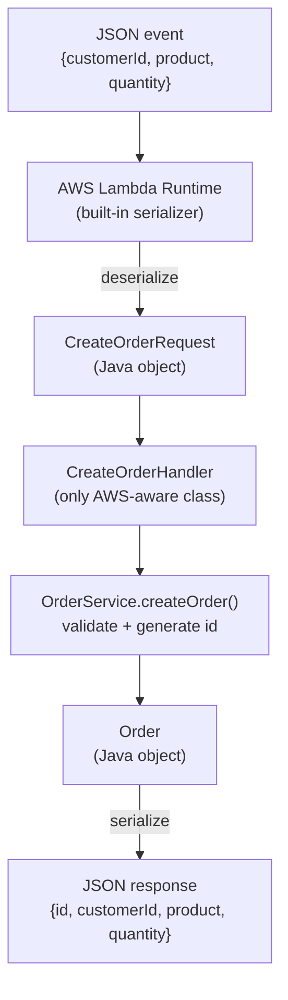

# Orders API

A small Order Management REST API designed, implemented and deployed progressively during the "Serverless REST API" workshop, using Java 17, Maven, AWS Lambda and Amazon API Gateway.

The API contract is designed first (this document). The implementation is added in later phases: first as plain Java, then deployed to AWS Lambda, and finally exposed through Amazon API Gateway.

## API Design

The API exposes a single resource: **Orders**. Customers and products are not resources of this API; they only appear as data inside an order.

An order is represented as:

```json
{
  "id": "ORD-001",
  "customerId": "CUST-42",
  "product": "MacBook Air",
  "quantity": 1
}
```

### Operations

#### Create an order — `POST /orders`

- **Path parameters:** none
- **Query parameters:** none
- **Request body:**

```json
{
  "customerId": "CUST-42",
  "product": "MacBook Air",
  "quantity": 1
}
```

- **Success:** `201 Created`, with the created order in the response body. The server generates the order `id`. A `Location` header points to the new resource: `/orders/{id}`.
- **Errors:**

| Case | HTTP status | Error code |
|---|---|---|
| Invalid request body (missing/blank fields, non-positive quantity) | 400 Bad Request | `INVALID_INPUT` |

#### Retrieve an order — `GET /orders/{id}`

- **Path parameters:** `id` — the order identifier (e.g. `ORD-42`)
- **Query parameters:** none
- **Request body:** none
- **Success:** `200 OK`, with the full order in the response body.
- **Errors:**

| Case | HTTP status | Error code |
|---|---|---|
| No order exists with that id | 404 Not Found | `ORDER_NOT_FOUND` |

#### Find orders by customer — `GET /orders?customerId={customerId}`

- **Path parameters:** none
- **Query parameters:** `customerId` (required) — the customer identifier (e.g. `CUST-42`)
- **Request body:** none
- **Success:** `200 OK`, with a JSON array of orders belonging to that customer. If the customer has no orders, the array is empty (`[]`) — this is a successful search without results, not an error.
- **Errors:**

| Case | HTTP status | Error code |
|---|---|---|
| Missing or blank `customerId` | 400 Bad Request | `INVALID_INPUT` |

### Error response format

All errors use a consistent JSON representation:

```json
{
  "error": "ORDER_NOT_FOUND",
  "message": "Order ORD-999 does not exist"
}
```

- `error`: a stable, machine-readable error code.
- `message`: a human-readable description of what happened.

The HTTP status code already carries the outcome of the request, so it is not repeated inside the body.

### Validation rules

- `customerId`: required, format `CUST-<digits>`.
- `product`: required, non-empty.
- `quantity`: positive integer (>= 1).

## Design Decisions

1. **What are the resources in this API?**
   Only one resource: orders. Customers and products appear as attributes of an order, but the API does not expose endpoints for them, so they are not resources.

2. **Why `/orders/{id}` to retrieve a particular order?**
   REST models a collection (`/orders`) and its individual items (`/orders/{id}`). The hierarchical path identifies the collection first and one specific item second, which is the standard and predictable way to address a single resource.

3. **Why is `customerId` a query parameter in the search operation?**
   Because the search filters the orders collection; it does not address a customer resource. Using `/orders/{customerId}` would collide with `/orders/{orderId}` and would imply a "customer" resource that this API does not have.

4. **What should `POST /orders` return when an order is successfully created?**
   `201 Created`, the created order (including the server-generated `id`) in the body, and a `Location` header with the URL of the new resource.

5. **What should the API return when an order does not exist?**
   `404 Not Found` with the standard error body (`ORDER_NOT_FOUND`), so clients can distinguish "bad request" from "resource not found".

6. **What information should an error response contain?**
   A stable machine-readable error code and a human-readable message. The HTTP status code conveys the outcome; the body explains it.

## Implementation (Part I — Plain Java)

The application logic is implemented as ordinary Java 17 with no HTTP, API Gateway, Spring or web-server dependencies.

```
orders-api/src/main/java/com/example/orders/
├── model/
│   ├── Order.java                   Immutable value object (id, customerId, product, quantity)
│   └── CreateOrderRequest.java      Raw input for creation; carries no validation logic
├── service/
│   └── OrderService.java            Validation, id generation and business operations
├── repository/
│   └── InMemoryOrderRepository.java In-memory storage backed by a LinkedHashMap
└── exception/
    ├── ValidationException.java     Invalid input
    └── OrderNotFoundException.java  Referenced order does not exist
```

**Where each responsibility lives:**

- **Model** — plain data; no validation, no infrastructure concerns.
- **OrderService** — application logic: validates input (customerId format `CUST-<digits>`, non-empty product, quantity >= 1), generates sequential ids (`ORD-001`, ...), and delegates storage to the repository.
- **InMemoryOrderRepository** — in-memory persistence; preserves insertion order so search results are deterministic. Not durable: Lambda execution environments are ephemeral.
- **Exceptions** — plain Java `RuntimeException`s carrying only a human-readable message. The mapping from these exceptions to HTTP status codes (`400`/`404`) deliberately lives nowhere yet; it will be introduced by a later HTTP adapter so the core stays infrastructure-free.

**Tests (JUnit 5):** 20 tests covering creation of a valid order, retrieval of an existing order, behavior when an order does not exist, searching by customer (including the empty case), and invalid input (null/blank/malformed fields, zero and negative quantity).

### Checkpoint 1

- **Can the application functionality be tested without AWS?**
  Yes. The service layer is plain Java over an in-memory repository; `mvn test` runs 20 JUnit tests without any AWS dependency.

- **Does the application require a web server?**
  No. Operations are plain method calls; nothing listens on a port.

- **Does it require Spring Boot?**
  No. The only dependency is JUnit, and only at test scope.

- **What does the generated JAR contain?**
  Only the compiled application classes (a "thin" JAR, ~8.5 KB). It does not bundle any dependencies. When deploying to Lambda in Part II, a shaded (fat) JAR including the AWS SDK libraries will be required.

- **Which parts of the application currently know about HTTP?**
  None. Validation and not-found failures are thrown as generic Java exceptions; choosing the HTTP status code for each will be the job of a future adapter.

## Part II — Deploying to AWS Lambda

The `createOrder` operation was deployed as the `Orders` function (Java 17, region `us-east-1`):

- **Handler:** `com.example.orders.lambda.CreateOrderHandler::handleRequest`
- `CreateOrderHandler` is a typed `RequestHandler<CreateOrderRequest, Order>` and is the **only class in the project importing AWS types**.
- The deployed artifact is a fat JAR (maven-shade-plugin) bundling `aws-lambda-java-core`. It does **not** bundle Jackson: JSON conversion is performed by the Lambda runtime itself.

### Investigation: how does the Lambda Java runtime map JSON to Java?

Deployed behavior (verified against the running function, see `evidence/aws/lambda-parte2.md` and `evidence/screenshots/`):

1. **Instantiation.** The runtime instantiates the handler class once per *execution environment* using its no-arg constructor, and reuses that object across invocations (warm start). This is why `OrderService` (and its in-memory repository + id counter) is created in the constructor.
2. **JSON → Java.** For a typed `RequestHandler<I, R>`, the runtime uses its **built-in serializer** (an internal Jackson `ObjectMapper` owned by the runtime, not by the application) to deserialize the event JSON into the declared input type, `CreateOrderRequest`.
3. **Java → JSON.** The returned `Order` object is serialized back to JSON by the same runtime serializer. Our fat JAR contains zero Jackson classes, yet the mapping still happened — the conversion is entirely runtime-owned.
4. **POJO shape matters.** The runtime's serializer requires the input type to have a no-arg constructor and setters (`CreateOrderRequest`), and reads the output type through its getters (`Order`). This is why the mutable `CreateOrderRequest` decision made in Part I paid off here.
5. **Errors are not HTTP.** An input that fails validation propagated as a raw function error: `errorType: ValidationException`, `errorMessage: "product must not be blank"` plus a stack trace. The invocation is simply "failed"; no HTTP status exists at this layer. Translating domain exceptions into HTTP codes (`400`, `404`) is the job of a later HTTP-facing layer (API Gateway or an adapter).

### Checkpoint 2



Observed with the deployed function: input `{"customerId":"CUST-42","product":"MacBook Air","quantity":1}` → output `{"id":"ORD-001",...}` on the first invocation; a second valid invocation on the same warm container returned `ORD-002` with ~0s execution time, confirming handler reuse; an invalid input produced a raw `ValidationException` error payload with no HTTP semantics.

## Build and Test

```bash
mvn test     # run unit tests (20 tests, all passing)
mvn package  # package the application (thin JAR: target/orders-api-1.0.0.jar)
```
